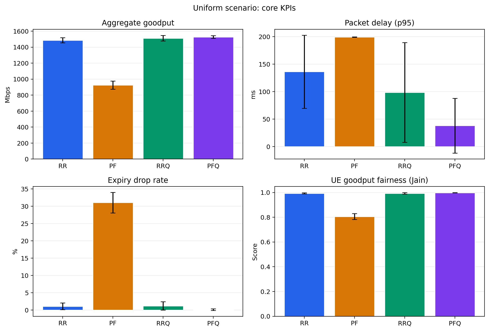
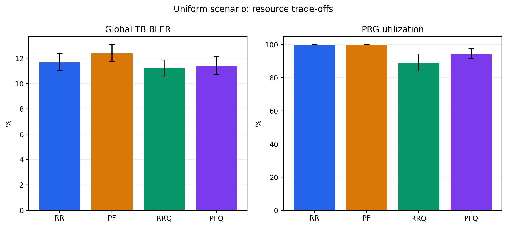
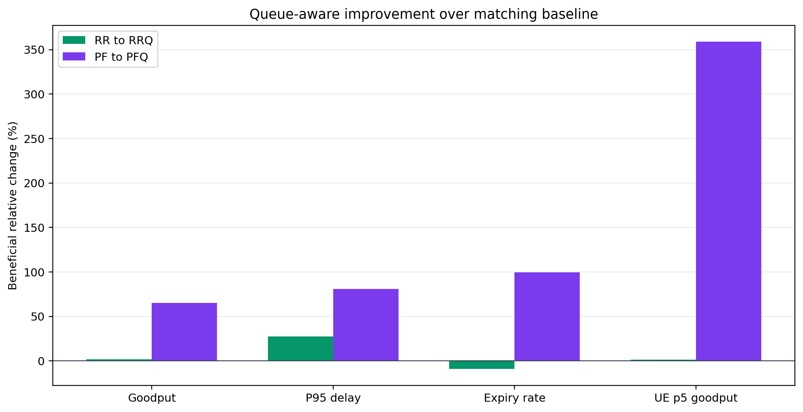
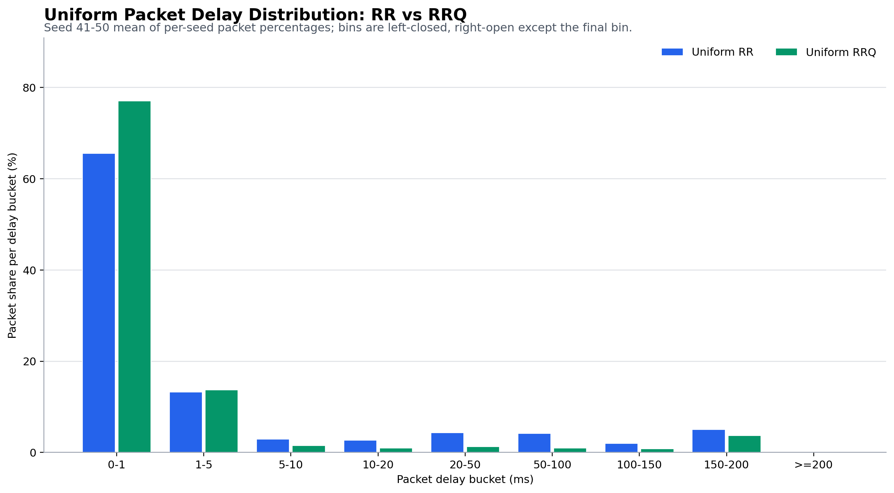
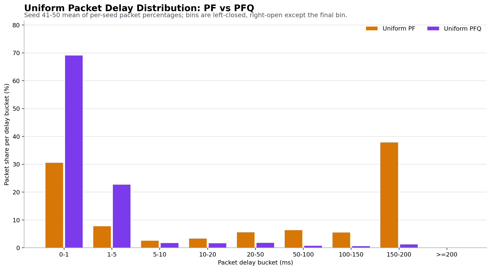
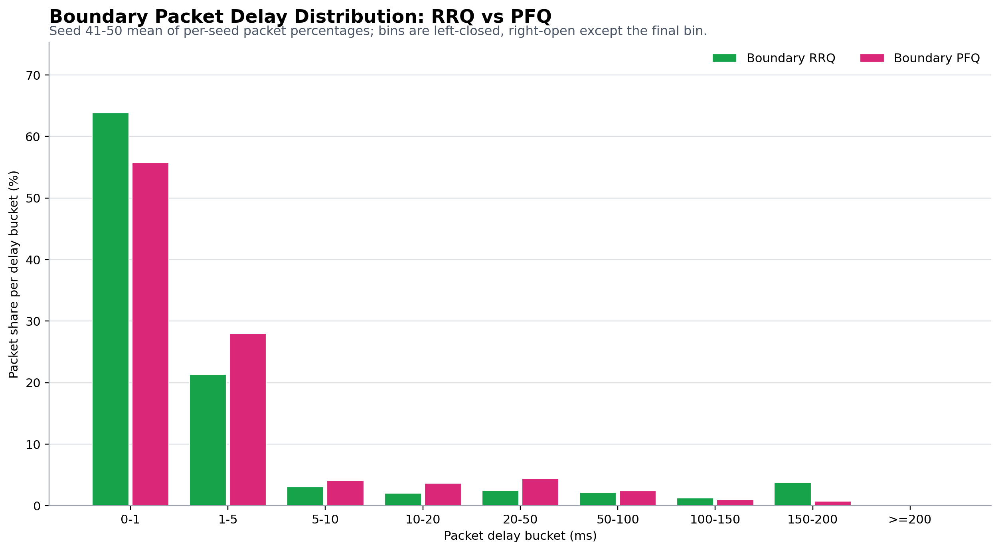

# Stage-B 历史基线验证与同频机制证据

> **历史归档，不是当前基线性能结论。** 本文合并旧《多维协同资源分配代表性技术仿真验证报告》《基线逐包时延分布分析》和《同频场景基线表现分析资料汇编》。2026-09-20 后续路线及 2026-10-20 物理/时序修正之后，这些旧结果已退出当前性能证据链。当前结果见 `Doc/stageB_current_progress.md`。
>
> 表内数值沿用旧产物，未重新仿真。旧 SVD 服务小区、阴影单位与动作时序已在后续实验中修正；这里的 MAC completed-only 指标也不等于修正版整包成功/全包终态指标。旧报告跨 seed 的 std 是**总体标准差**，不得混作当前报告的样本标准差。历史比较只适用于其原始批次。
>
> **资源粒度勘误：** 原同频资料把 active gate / full-KPI 写成 `68 PRG × 4 PRB`，与验收报告从 80 份 wrapper log 核验的 `17 PRG × 16 PRB` 冲突。本合并稿采用后者，并修正历史配置矩阵；第 21 节明确单独运行的 68-PRG ONNX pilot 仍保留原粒度，不与 17-PRG 批次合并。

原验收报告与来源节标题保留，编号按来源保留。重复写作提纲、重复 baseline 摘要和重复 boundary 汇总已删除；完整指标、分桶、逐 seed 表、配置未知项及动作后干扰审计集中在附录。


**文档性质：** 项目验收材料

**验证对象：** RR、PF、RRQ、PFQ 四类 Type-0 时频资源调度基线

**主证据批次：** `output/stageB_baseline_eval_suite_fullkpi_seed41_50/`

**统计范围：** paired seeds 41--50；表中 `mean ± std` 为先按 seed 统计、再跨 10 个 seed 求算术均值与总体标准差；误差不是置信区间

**结论适用范围：** 本报告所列三小区、Rayleigh、SVD、4T4R、Type-0、固定高负载业务与 4000 TTI 仿真条件

## 执行摘要

本次验证在可追溯的 Stage-B GPU Type-0 调度链路上，对 RR、PF、RRQ、PFQ 四类代表性基线进行了同拓扑、同信道、同业务、同仿真时长及同随机种子的配对比较。四类算法均能完成运行并产出吞吐、包时延、TTL 过期、弱 UE 吞吐、公平性、TB BLER、PRG 利用率及包完成状态等 KPI，满足功能执行、配对比较、KPI 完整性和结果追溯要求。

统一四算法主线采用 full-KPI suite 的 **uniform** 场景。PFQ 在该条件下取得 1527.240 ± 16.945 Mbps goodput、38.000 ± 49.942 ms p95 时延、0.117 ± 0.215% 过期率、39.190 ± 1.570 Mbps UE goodput p5 和 0.997899 ± 0.001119 Jain 公平性，是本次工况下综合表现最强的基线；其 PRG 利用率为 94.509 ± 2.974%，TB BLER 为 11.422 ± 0.703%，说明结论应按收益和资源/可靠性代价联合理解。RRQ 相对 RR 改善 goodput 和已完成包尾时延，但过期率均值未同步改善。当前 PF 路径在该高负载、queue-unaware 实现下发生明显退化；该现象只描述当前实现与工况，不能外推为比例公平理论在一般条件下失效。

full-KPI **boundary** 结果作为同一 suite 内的独立边缘场景证据：PFQ 相对 RRQ 的 goodput 为 +21.710 Mbps、p95 为 -52.850 ms、过期率为 -1.199 个百分点、UE p5 为 +4.124 Mbps。另一个独立的 active boundary gate 仅用于方向交叉核验，得到 goodput +6.903 Mbps、p95 -30.428 ms、过期率 -0.592 个百分点、UE p5 +1.935 Mbps、Jain +0.002475。两批 boundary 数值未拼接为同一次实验结果。

综合判断：本次代表性基线仿真验证达到既定技术验证目的，可作为后续 AI 调度方案的量化比较基础；但现有结果缺少原始运行时 Git commit hash、dirty patch、容器镜像 digest、编译选项 hash 和统一配置 hash，因此 bit-exact 可复现性仅部分满足。

## 1. 项目背景与验证目标

项目需要在后续智能资源调度研发之前建立可执行、可量化、可审计的传统与增强基线。本报告的目标是：

1. 验证四类基线在当前 CUDA 加速 Type-0 调度链路上均可运行；
2. 在统一条件下比较系统吞吐、时延尾部、包过期、弱 UE、公平性、可靠性和资源占用；
3. 说明 queue-aware 改造在高负载业务中的收益及代价；
4. 建立后续 AI 调度必须在同一场景、同一 KPI 口径下超过的参考基准；
5. 明确证据边界和可复现性缺口，避免从有限仿真结果作普遍化外推。

RR、PF、RRQ、PFQ 均为本项目选取的代表性基线，**不是 AI 算法**。其中 Q 仅表示本项目的 queue-aware 实现，不是标准化算法名称。

## 2. 验证对象及多维资源分配映射

当前 Type-0 路径先将所有 active UE 放入候选集合，四类基线的核心差异主要落在逐 PRG bitmap 分配，而非旧 Type-1 语义下完整的“UE selection + 连续资源分配”两阶段流程。

| 维度 | 仿真中的可验证对象 | 主要指标 |
|---|---|---|
| 时间 | TTI 级调度、队列等待、包 TTL | mean/p90/p95 delay、expiry、pending packet |
| 频率 | PRG bitmap、PRG 占用与同频复用 | PRG utilization、goodput、served throughput |
| 功率/链路 | 信道质量、SVD 后可达率、传输成败 | TB BLER、goodput、可达速率相关 PF 权重 |
| 空间 | 3-cell 同频、4T4R、边缘 UE、strongest association | UE p5/p10、Jain、公平性、boundary 对比 |
| 业务/队列 | buffer、demand cap、TTL 压力 | completed/expired/pending packet、tail delay |

这里的“功率/链路”和“空间”维度体现为调度器对链路质量、MIMO/预编码结果及空间干扰场景的观测和响应。四类基线**不直接优化发射功率，也不执行跨小区联合动作**；各小区内的调度动作在共同载频上形成簇内同频干扰。

## 3. RR、PF、RRQ、PFQ 算法原理

| 算法 | 项目实现语义 | 主要机制 | 预期收益与风险 |
|---|---|---|---|
| RR | 原始轮询式 PRG 分配 | 按小区关联 UE 尽量均分 PRG，余数顺序补齐 | 机制简单、占用充分；不显式利用队列需求与信道机会 |
| PF | 当前原始比例公平路径 | 以瞬时可达率与历史平均速率构造 PF 权重 | 权衡信道机会与长期服务历史；当前路径缺少高负载业务所需的充分队列约束 |
| RRQ | 本项目 queue-aware RR | 在 RR 基础上引入队列需求约束和 demand cap | 可减少超需求分配并改善部分时延；不保证过期、公平性等所有指标同步改善 |
| PFQ | 本项目 queue-aware PF | PF 基础分数叠加 buffer weight、demand cap 和 TTI 内衰减 | 抑制超需求集中分配和危险长尾；可能增加占用或牺牲部分极短时延包/单包速率指标 |

PFQ 的基础权重保留 `rate^beta / avgRate` 形式，并叠加 buffer 权重；demand cap 依据 buffer、单 PRG 瞬时可服务字节和 slack 限制超需求分配，intra-TTI decay 则随同一 UE 在本 TTI 已获 PRG 数增加而衰减。当前定稿不包含历史试验中的二阶段 relaxed idle-PRG fill。

## 4. 仿真平台与软硬件环境

验证使用仓库现有 CUDA 加速 cuMAC Stage-B 仿真链路，执行 GPU Type-0 bitmap 调度。PHY/场景的已确认配置如下。

| 类别 | 配置 |
|---|---|
| 小区与 UE | 3 个相邻全向小区，36 个 active UE，12 UE/cell |
| 天线 | BS/UE 4T4R；不等同于每次传输固定 4 层 |
| 信道 | Rayleigh |
| 预编码 | SVD |
| 资源分配 | Type-0 bitmap |
| 载频 / SCS | 2.5 GHz / 30 kHz |
| TTI | 0.5 ms |
| 总资源 | 272 PRB/cell |
| 执行链路 | native GPU scheduler；聚合数据按 run log 与 manifest 追溯 |

现有运行产物没有完整固化 GPU 型号、驱动/工具链组合、容器镜像 digest 及编译选项 hash。本报告不据此声称已恢复原始运行时的精确软硬件镜像。

### 4.1 实际 PRG 粒度核验

批准设计要求按各批实际命令/manifest 记录资源分组。full-KPI 批次保留 60 份、active boundary gate 批次保留 20 份，共 80 份 seed wrapper log，均记录 `nPrbGrpsConst 17`；结合 272 PRB，可核验为 17 PRG/cell、16 PRB/PRG。

| 数据批次 | 实际记录 | 报告使用方式 |
|---|---|---|
| full-KPI uniform 四算法 | 17 PRG × 16 PRB = 272 PRB/cell | 四算法主线 |
| full-KPI boundary RRQ/PFQ | 17 PRG × 16 PRB = 272 PRB/cell | boundary 完整 KPI 与逐包分布 |
| active boundary gate | 17 PRG × 16 PRB = 272 PRB/cell | 独立方向交叉核验 |

三批实际粒度相同，但仍属于独立运行批次；相同资源粒度不构成混合其绝对数值的理由。

## 5. 同频三小区场景及业务模型

三个小区共享同一载频和同一 PRG 编号空间，频率复用因子可按 1 理解。不同小区在同一 TTI、同一 PRG index 上的并发传输形成协调簇内部的同频干扰。场景没有簇外干扰小区，也没有 handover 或动态负载均衡证据。

uniform 主场景用于四算法横向验收；boundary 场景将 UE 布置在更具边缘性的区域并采用 strongest-cell association，用于核验弱 UE 与不均衡链路条件。placement 同时改变关联、信道和队列演化，因此不把跨 placement 的单个 KPI 变化全部归因于干扰强弱。

业务为每 UE 一条固定 3000 Byte 下行 flow，逐 UE 按 Poisson 过程到达，均值 `1.0 pkt/TTI/UE`。单 TTI 可到达 0、1 或多个包。理论 offered load 为：

```text
36 UE × 3000 Byte × 8 bit/Byte × 1 pkt/TTI / 0.0005 s = 1.728 Gbps
```

每个 seed 仿真 4000 TTI，即 2.0 s；TTL 为 200 ms，即 400 TTI；三批运行的 warm-up 均为 0 TTI。有限时窗内实际生成量随 Poisson realization 波动。

## 6. 验证指标与验收判据

### 6.1 KPI 口径

| KPI | 统计含义 | 解读限制 |
|---|---|---|
| goodput | PHY 侧 `tbErr == 0` 的有效字节除以仿真时间 | 系统级主吞吐指标；不同于 MAC served estimate |
| p95 delay | 对 MAC tracker 中完全出队的 completed packet 统计 enqueue-to-completion 时延的 seed 内 p95 | expired/pending 不进入样本，必须联读状态计数 |
| expiry | TTL 到期移除字节占生成字节比例 | 源 CSV 为 0--1 ratio，报告乘 100 显示为 `%` |
| UE goodput p5 | per-UE goodput 的 5% 分位 | 弱 UE 体验代理，不等同于几何位置标签 |
| Jain fairness | per-UE goodput 的 Jain 指数 | 接近 1 表示分布更均衡 |
| TB BLER | 调度 TB 的错误比例 | 源 ratio 乘 100；低 BLER 不必然对应最高 goodput |
| PRG utilization | 已分配 PRG opportunity / 总 PRG capacity | 源 ratio 乘 100；高占用不等同于高频谱效率 |
| completed/expired/pending | 完全离开 MAC tracker / TTL 移除 / 仿真结束仍残留的包或残片 | 用于识别 completed-only 时延的选择性 |

所有百分比均按源 ratio × 100 转换；百分点差值记为 pp。跨 seed 标准差反映随机场景离散性，不作统计显著性声明。

### 6.2 验收判据

1. **功能性：** 四算法均可通过现有 GPU Type-0 链路执行并产出 KPI；
2. **公平比较：** 同批比较使用一致拓扑、信道、业务、时长、资源粒度及 paired seeds；
3. **完整性：** 覆盖 goodput、served、时延、expiry、UE p5/p10、公平性、BLER、PRG utilization 和 packet completion 状态；
4. **可追溯性：** 核心数值可追溯到聚合 CSV/JSON、seed manifest、运行日志和脚本；
5. **可复现性：** 区分脚本/manifest 级复现与 bit-exact 复现。

验收不要求单一算法在所有 KPI 上获胜，而是要求机制可运行、比较受控、结果完整且结论边界清楚。

## 7. 试验设计、变量控制及随机种子

full-KPI suite 分为三个配对子任务：uniform RR/PF、uniform RRQ/PFQ、boundary RRQ/PFQ，再由 suite aggregate 形成统一表。每个子任务都包含 seeds 41--50，聚合文件的 `common_seed_count=10`，各算法 seed 列与共同 seed 列一致。

控制变量包括：3 cells、36 active UEs、12 UE/cell、4T4R、Rayleigh、SVD、Type-0、2.5 GHz、30 kHz SCS、0.5 ms TTI、272 PRB、17 PRG、3000 Byte 固定包、Poisson 1.0 pkt/TTI/UE、4000 TTI、200 ms TTL 与相同 seed。算法是同批配对中的主要变化量。

统计流程为：每个 seed 独立计算 KPI，再对 10 个 seed 的 KPI 求均值和总体标准差。差值使用 paired seed 聚合字段；逐包直方图则先在每个 seed 内计算桶占比，再对 seed 等权平均，避免包数较多的 seed 获得更大权重。

证据层次严格如下：

- **full-KPI uniform：** RR/PF/RRQ/PFQ 四算法验收主线；
- **full-KPI boundary：** 同一 suite 内 RRQ/PFQ 的完整边缘 KPI 和 completed-packet 分布；
- **active boundary gate：** 独立运行批次，仅检查 PFQ 相对 RRQ 的结论方向。

## 8. 四算法统一对比结果

下表只取 full-KPI suite 的 uniform 聚合 CSV，未混入 boundary 或 active gate 数据。

| 指标 | RR | PF | RRQ | PFQ |
|---|---:|---:|---:|---:|
| goodput (Mbps) | 1486.396 ± 31.771 | 925.656 ± 50.922 | 1512.253 ± 35.026 | 1527.240 ± 16.945 |
| p95 delay (ms) | 136.100 ± 66.598 | 199.200 ± 0.245 | 98.550 ± 90.659 | 38.000 ± 49.942 |
| expiry (%) | 1.080 ± 0.961 | 31.023 ± 2.986 | 1.179 ± 1.207 | 0.117 ± 0.215 |
| UE goodput p5 (Mbps) | 34.891 ± 3.594 | 8.542 ± 1.280 | 35.374 ± 4.763 | 39.190 ± 1.570 |
| Jain fairness | 0.993380 ± 0.004774 | 0.805345 ± 0.024030 | 0.993267 ± 0.005662 | 0.997899 ± 0.001119 |
| TB BLER (%) | 11.706 ± 0.665 | 12.411 ± 0.656 | 11.240 ± 0.634 | 11.422 ± 0.703 |
| PRG utilization (%) | 99.999 ± 0.002 | 100.000 ± 0.000 | 89.193 ± 5.149 | 94.509 ± 2.974 |







### 8.1 结果解释

- RR 保持近满 PRG 占用和较高 goodput，但 completed-only p95 与 expiry 表明高负载下仍存在尾部压力。
- RRQ 相对 RR 的 goodput 增加 25.857 Mbps，p95 降低 37.550 ms，PRG 利用率下降 10.806 pp；但 expiry 由 1.080% 增至 1.179%，说明 queue-aware demand cap 的收益不能概括为所有包可靠性指标全面改善。
- PF 当前路径 goodput 为 925.656 Mbps、expiry 为 31.023%、p95 接近 TTL。该结果说明当前高负载 queue-unaware 实现发生队列失配；它不是对 PF 理论的一般性否定。
- PFQ 相对当前 PF 同时改善 goodput、尾时延、过期率、弱 UE 和 Jain，并降低 5.491 pp PRG 占用；这体现当前 queue-aware 机制对该实现的修正效果。
- PFQ 在四算法中具有最均衡的综合 KPI 和较小的 goodput、UE p5、Jain 离散性，因而被认定为本工况下后续 AI 调度应优先对标的强基线，而非宣称其在所有场景普遍最优。

## 9. 时延分布、吞吐、公平性和资源利用分析

### 9.1 Uniform RR 与 RRQ



RRQ 将 `0--1 ms` completed-packet 占比从 65.552% 提高到 77.063%，将 `50--200 ms` 尾部占比从 11.224% 降到 5.485%。与此同时，每 seed completed packet 从 139,148.7 增至 139,813.3，pending 从 2,282.3 降至 1,353.7，但 expired packet 从 2,641.2 增至 2,905.2。由此只能确认 RRQ 改善已完成包分布和末端残留，不能据 completed-only p95 推断所有到达包都获得改善。

### 9.2 Uniform PF 与 PFQ



当前 PF 的 `150--200 ms` completed-packet 占比为 37.944%，PFQ 为 1.269%；completed packet 从每 seed 83,639.1 增至 143,178.7，expired 从 49,763.0 降至 283.5，pending 从 10,670.1 降至 610.0。三类状态与分布共同说明 PFQ 避免了当前 PF 实现中的 TTL 临界堆积；仅看 PF 的 100% PRG 占用会掩盖业务层退化。

### 9.3 completed-only 统计限制

普通 delay 样本只来自完全离开 MAC packet tracker 的包。达到 TTL 而被移除的包以及仿真结束仍 pending 的包不进入分布，因此图中 `≥200 ms` 为 0 并不代表没有 TTL 风险。尤其当算法间 completed、expired、pending 数差异很大时，p95 必须与三类状态计数联读；本报告所有时延结论均遵循该限制。

goodput 是 PHY 成功解码的系统级有效吞吐，而 completed packet 是 MAC tracker 的完全出队事件。两者不能按固定包长简单当作同一完成语义。PRG utilization 只表示资源机会被分配的比例，高利用率也不自动表示单位资源效率更高。

## 10. Boundary 边缘用户增强验证

### 10.1 full-KPI boundary：正式边缘场景表

下表仅使用 full-KPI suite 中 `boundary_rrq_pfq_metrics.csv`。差值为 paired `PFQ - RRQ`；百分比差值使用百分点。

| 指标 | Boundary RRQ | Boundary PFQ | PFQ - RRQ |
|---|---:|---:|---:|
| goodput (Mbps) | 1494.513 ± 33.711 | 1516.222 ± 17.190 | +21.710 |
| p95 delay (ms) | 94.700 ± 73.961 | 41.850 ± 30.602 | -52.850 |
| expiry (%) | 1.282 ± 1.427 | 0.083 ± 0.112 | -1.199 pp |
| UE p5 (Mbps) | 34.829 ± 4.704 | 38.954 ± 1.084 | +4.124 |
| Jain fairness | 0.992767 ± 0.006513 | 0.998177 ± 0.000836 | +0.005409 |
| PRG utilization (%) | 94.350 ± 6.055 | 98.598 ± 2.218 | +4.248 pp |



PFQ 的 `0--1 ms` completed 占比低于 RRQ（55.729% 对 63.839%），但 `150--200 ms` 从 3.770% 降至 0.760%。这说明 PFQ 并非让每个包都更快，而是减少两极化并把部分危险长尾移入 1--100 ms 区间。每 seed completed 从 139,301.3 增至 143,025.5，expired 从 3,103.7 降至 186.4，pending 从 1,667.2 降至 860.3，与 tail 治理方向一致。代价是 PRG utilization 增加 4.248 pp，TB BLER 亦由 11.635% 增至 11.823%（+0.188 pp）。

### 10.2 active boundary gate：独立交叉核验

active gate 位于：

`output/stageB_rrq_pfq_multiseed_compare_coopboundary_assocstrongest_legacyshadow_r500_t4000_w0_s41_s50/`

该批次与 full-KPI boundary 独立运行，绝对均值不同，故只列方向核验，不将其 KPI 填入上一表：

| PFQ 相对 RRQ | active gate 差值 |
|---|---:|
| goodput | +6.903 Mbps |
| expiry | -0.592 pp |
| p95 delay | -30.428 ms |
| UE goodput p5 | +1.935 Mbps |
| Jain fairness | +0.002475 |

五项方向均与 full-KPI boundary 一致，支持 PFQ 在 paired seeds 41--50 下的 tail、expiry 和弱 UE 改善具有跨独立运行批次的方向稳定性；但本报告不把这种一致性表述为统计显著性或所有 seed 逐一获胜。

## 11. 多维协同能力分析

时间维上，RRQ/PFQ 的队列约束以及 PFQ 的单 TTI 衰减改变服务次序和等待尾部，证据为 p95、expiry 及 pending 状态。频率维上，Type-0 bitmap 和 demand cap 改变 PRG 分配密度，证据为 PRG utilization 与 goodput 的联合变化。功率/链路维上，PF/PFQ 使用 SVD 后可达率相关信息，TB BLER 与 goodput 反映调度选择在给定链路条件下的结果。空间维上，三小区同频和 boundary strongest association 提供链路不均衡与簇内复用环境，UE p5/p10 与 Jain 反映弱 UE 和分配均衡性。业务维上，buffer、TTL 和 Poisson 到达通过 completed/expired/pending 及 tail delay 得到验证。

上述能力属于“给定链路和空间场景下的时频与队列感知调度”。本次基线动作空间不包含发射功率变量，也没有跨小区联合动作优化；因此“多维协同”不能扩展解释为功控、波束与跨小区动作的统一联合最优化。

## 12. 验证结论与验收符合性

| 验收项 | 状态 | 证据与判断 |
|---|---|---|
| 功能执行 | 满足 | RR、PF、RRQ、PFQ 均完成 10-seed 运行并生成聚合 KPI |
| 配对比较 | 满足 | common seeds 与算法 seed 均为 41--50，同批变量受控 |
| KPI 完整性 | 满足 | 覆盖吞吐、时延、expiry、弱 UE、公平性、BLER、资源占用和包状态 |
| 可追溯性 | 满足 | 可追溯至 CSV/JSON、seed manifest、wrapper log、脚本与图表 |
| bit-exact reproduction provenance | 部分满足 | 具备脚本/manifest 级路径，但缺少五项原始运行时 provenance |

验收结论如下：

1. 四类代表性资源分配基线均已在当前 Type-0 GPU 链路完成多 seed 功能及 KPI 验证；
2. full-KPI uniform 数据足以建立四算法统一比较基准；
3. PFQ 是当前工况下综合最强基线，主要价值是高负载 queue-aware tail/expiry 治理及弱 UE 稳定性，而不是数量级容量增益；
4. full-KPI boundary 与独立 active gate 给出一致方向，支持将 PFQ 作为后续 AI 调度的强比较基准；
5. 本次验收结论为“验证目的达到、运行时 bit-exact provenance 部分满足”。

## 13. 局限性及后续 AI 技术演进建议

### 13.1 局限性

- 结论仅覆盖三小区协调簇内部同频干扰，不含簇外干扰、handover 或动态负载均衡；
- 信道为 Rayleigh、预编码为 SVD；不能外推到 CDL/TDL、不同天线或所有传播条件；
- 单一高负载、固定包长、固定 TTL 和 2 s horizon 不能代表所有业务负载；
- 4T4R 不表示固定四层，实际层选择与传输结果仍受链路条件影响；
- PF 的退化限定于当前 queue-unaware 路径和高负载工况，不能外推为 PF 理论普遍失效；
- completed-only delay 存在选择性，必须与 expired/pending 联读；
- 没有统计假设检验或置信区间，`mean ± std` 只表示 10 个 seed 的描述统计；
- 结果产物未固化部分 PHY、队列容量及运行环境细节，禁止据此作未记录机制的因果解释。

### 13.2 后续 AI 演进建议

后续智能算法首先应复用同一 full-KPI uniform/boundary 配置、paired seeds 和 KPI 口径，与 PFQ 而非当前 raw PF 作主比较。评价函数至少联合 goodput、p95、expiry、UE p5/Jain、BLER 和 PRG utilization，避免通过只优化单一 completed-packet 指标获得表面改善。若未来扩展功率、波束或跨小区动作，应显式扩大动作空间并新增相应约束、合法性检查和独立验收项，不能把本次基线观察维度当作已实现的联合控制能力。

# 技术附录

## 附录 A：仿真参数配置总表

| 参数 | full-KPI uniform | full-KPI boundary | active boundary gate |
|---|---:|---:|---:|
| cells / active UE | 3 / 36 | 3 / 36 | 3 / 36 |
| UE per cell | 12 | 12 | 12 |
| antenna | 4T4R | 4T4R | 4T4R |
| fading / precoding | Rayleigh / SVD | Rayleigh / SVD | Rayleigh / SVD |
| allocation | Type-0 bitmap | Type-0 bitmap | Type-0 bitmap |
| carrier / SCS | 2.5 GHz / 30 kHz | 2.5 GHz / 30 kHz | 2.5 GHz / 30 kHz |
| TTI / horizon | 0.5 ms / 4000 TTI | 0.5 ms / 4000 TTI | 0.5 ms / 4000 TTI |
| PRB / PRG | 272 / 17 | 272 / 17 | 272 / 17 |
| PRB per PRG | 16 | 16 | 16 |
| packet / arrival | 3000 B / Poisson 1.0 pkt/TTI/UE | 同左 | 同左 |
| TTL / warm-up | 200 ms / 0 TTI | 200 ms / 0 TTI | 200 ms / 0 TTI |
| seeds | 41--50 paired | 41--50 paired | 41--50 paired |
| scheduler | RR, PF, RRQ, PFQ | RRQ, PFQ | RRQ, PFQ |

## 附录 B：统计层级与公式

对算法 `a`、seed `s` 的 KPI 记为 `x(a,s)`，报告均值与总体标准差为：

```text
mean_a = (1/10) × Σ_s x(a,s)
std_a  = sqrt[(1/10) × Σ_s (x(a,s) - mean_a)^2]
```

paired 差值先在共同 seed 上作算法差，再聚合。百分比源字段如 `expiry_drop_rate=0.0108002`，报告显示为 `1.08002%`；ratio 差 `-0.0119901` 显示为 `-1.19901 pp`。

Jain 公平性为：

```text
J = (Σ_i x_i)^2 / (N × Σ_i x_i^2)
```

理论 offered load 为 1.728 Gbps；期望生成包数为 `36 × 4000 × 1 = 144,000 packet/seed`，但实际值受有限 Poisson realization 影响。

## 附录 C：代码模块与调用链

```text
run_stageB_baseline_eval_suite.sh
  -> run_stageB_rr_pf_multi_seed_compare.sh
    -> run_stageB_main_experiment.sh
      -> main.cpp: Type-0 active UE population / 参数注入 / KPI 日志
      -> multiCellScheduler.cu / multiCellSchedulerCpu.cpp: PF/PFQ bitmap 分配
      -> roundRobinScheduler.cu / roundRobinSchedulerCpu.cpp: RR/RRQ bitmap 分配
  -> seed compare CSV/JSON
  -> suite aggregate CSV/JSON + packet-delay samples/bins
  -> plot_stageB_baseline_verification_report.py
  -> 本报告图表与表格
```

主要代码入口：

- `cuMAC/examples/multiCellSchedulerUeSelection/main.cpp`
- `cuMAC/src/4T4R/multiCellScheduler.cu`
- `cuMAC/src/4T4R/multiCellSchedulerCpu.cpp`
- `cuMAC/src/4T4R/roundRobinScheduler.cu`
- `cuMAC/src/4T4R/roundRobinSchedulerCpu.cpp`

## 附录 D：一键运行与绘图命令

按批准设计保留的 suite 复现命令：

```bash
cuMAC/scripts/run_stageB_baseline_eval_suite.sh \
  --build-method phase4 \
  --seed-list 41,42,43,44,45,46,47,48,49,50 \
  --suite-output-dir output/stageB_baseline_eval_suite_reproduce
```

从现有 full-KPI 聚合数据生成报告专用图：

```bash
python3 cuMAC/scripts/plot_stageB_baseline_verification_report.py \
  --suite-dir output/stageB_baseline_eval_suite_fullkpi_seed41_50 \
  --output-dir Doc/figures/stageB_baseline_verification
```

复现时必须检查新 run 的实际 `nPrbGrpsConst`、PRB/PRG 配置及 manifest，不因命令入口相同而假设与本报告保留批次 bit-exact 一致。

## 附录 E：证据索引

| 证据 | 仓库相对路径 | 用途 |
|---|---|---|
| uniform 四算法 CSV | `output/stageB_baseline_eval_suite_fullkpi_seed41_50/suite_aggregate/uniform_four_baseline_metrics.csv` | 第 8 节主表 |
| uniform 四算法 JSON | `output/stageB_baseline_eval_suite_fullkpi_seed41_50/suite_aggregate/uniform_four_baseline_metrics.json` | 机器可读交叉核对 |
| boundary CSV | `output/stageB_baseline_eval_suite_fullkpi_seed41_50/suite_aggregate/boundary_rrq_pfq_metrics.csv` | 第 10.1 节 |
| packet bins | `output/stageB_baseline_eval_suite_fullkpi_seed41_50/suite_aggregate/figures/packet_delay_distribution_bins.csv` | 三张时延分布图 |
| packet by seed | `output/stageB_baseline_eval_suite_fullkpi_seed41_50/suite_aggregate/figures/packet_delay_distribution_by_seed.csv` | seed 等权分桶审计 |
| packet samples manifest | `output/stageB_baseline_eval_suite_fullkpi_seed41_50/suite_aggregate/packet_delay_samples_manifest_all.csv` | 样本行与来源追踪 |
| full-KPI seed manifests | `output/stageB_baseline_eval_suite_fullkpi_seed41_50/*/scenario_seed_manifest.csv` | seeds/run 路径追踪 |
| active gate CSV | `output/stageB_rrq_pfq_multiseed_compare_coopboundary_assocstrongest_legacyshadow_r500_t4000_w0_s41_s50/RAYLEIGH/rrq_vs_pfq_compare_mean.csv` | 第 10.2 节独立交叉核验 |
| active gate seed manifest | `output/stageB_rrq_pfq_multiseed_compare_coopboundary_assocstrongest_legacyshadow_r500_t4000_w0_s41_s50/scenario_seed_manifest.csv` | paired seeds 追踪 |
| 报告绘图脚本 | `cuMAC/scripts/plot_stageB_baseline_verification_report.py` | 专用图生成 |

## 附录 F：可复现性声明与 provenance 缺口

当前仓库可证明：运行入口脚本存在，聚合 manifest 可列出 seed 41--50 和 run/compare 路径，CSV/JSON 可追溯核心数值，wrapper log 可核验实际 PRG 常量，绘图可由保留 CSV 重新生成。因此本报告具备**脚本级和 manifest 级可追溯性**。

现有原始运行产物未固化以下五项信息：

1. 原始实验运行时 Git commit hash；
2. 原始实验运行时 dirty patch；
3. 原始实验容器镜像 digest；
4. 原始实验 compiler options hash；
5. 原始实验 unified configuration hash。

上述缺口意味着无法对上游原始测量作 bit-exact reproduction 声明。当前可执行的是按现有脚本、manifest 和保留配置进行同口径重跑，并比较 KPI 方向与统计范围；未来验收批次应在 run 启动时自动固化这五项 provenance。

## 附录 G：报告内图表索引

- `Doc/figures/stageB_baseline_verification/uniform_core_kpis.png`
- `Doc/figures/stageB_baseline_verification/uniform_resource_tradeoffs.png`
- `Doc/figures/stageB_baseline_verification/queue_aware_improvements.png`
- `Doc/figures/stageB_baseline_verification/packet_delay_uniform_rr_vs_rrq.png`
- `Doc/figures/stageB_baseline_verification/packet_delay_uniform_pf_vs_pfq.png`
- `Doc/figures/stageB_baseline_verification/packet_delay_boundary_rrq_vs_pfq.png`

---

**最终声明：** 本报告验收的是四类代表性基线在所列 Stage-B 工况下的可执行性、受控比较、KPI 完整性与可追溯性。量化结果是该历史阶段的比较基准，已不作为当前修正版 AI 调度的比较基准，不构成对未验证拓扑、信道、负载、功控或跨小区动作空间的性能承诺。

# 历史完整指标与逐包分布附录

本文档基于 `output/stageB_baseline_eval_suite_fullkpi_seed41_50` 中 seed 41-50 的完整基线评估结果。逐包时延柱形图采用每个 seed 先计算各时延桶包占比，再对 10 个 seed 求平均的方式，因此不会让包数更多的 seed 获得更高权重。

时延桶为 `0-1, 1-5, 5-10, 10-20, 20-50, 50-100, 100-150, 150-200, >=200 ms`。除特别说明外，KPI 表中的数值为 `mean ± std`，std 为 seed 维度的总体标准差。`后 5% 时延阈值 p95` 表示 95% 已完成包不超过该时延，剩余后 5% 位于该阈值以上。`PRG/RB 利用率` 使用现有 `global_kpi.prg_utilization_ratio`，可近似理解为 RB 组资源利用率。BLER、过期丢包率、PRG/RB 利用率在表格中均按百分数显示，差值列使用 percentage point（pp）。


## 1. Uniform 场景：RR vs RRQ

### KPI 数据

| 指标 | Uniform RR | Uniform RRQ | RRQ - RR | 单位 | 说明 |
| --- | ---: | ---: | ---: | --- | --- |
| 估计服务吞吐（越高越好） | 1682.939 ± 32.428 | 1692.384 ± 37.142 | +9.445 | Mbps | MAC served bytes 估计吞吐，用于观察调度器是否实际送出数据 |
| Goodput（越高越好） | 1486.396 ± 31.771 | 1512.253 ± 35.026 | +25.857 | Mbps | PHY 成功解码字节吞吐；不等于整包完成或过期率的补数 |
| 包统计有效速率 R_pkt（越高越好） | 1.911 ± 1.328 | 10.077 ± 12.144 | +8.165 | Mbps | 按已完成包的 payload bits / 包系统时间计算，反映包视角服务效率 |
| 逐包平均有效速率（越高越好） | 33.761 ± 2.781 | 39.498 ± 2.130 | +5.737 | Mbps | 每个已完成包各自速率的算术平均 |
| UE-macro 包有效速率（越高越好） | 29.003 ± 3.053 | 35.117 ± 2.933 | +6.114 | Mbps | 先按 UE 统计包有效速率，再对 UE 等权平均 |
| UE-macro 逐包平均速率（越高越好） | 32.677 ± 2.649 | 38.411 ± 2.559 | +5.733 | Mbps | 先按 UE 统计逐包平均速率，再对 UE 等权平均 |
| 平均包时延（越低越好） | 17.692 ± 8.101 | 10.154 ± 8.129 | -7.539 | ms | 所有已完成包的 enqueue 到完全离队时延均值 |
| p50 包时延（越低越好） | 0.500 ± 0.000 | 0.500 ± 0.000 | 0.000 | ms | 50% 已完成包不超过该时延 |
| p90 包时延（越低越好） | 73.800 ± 48.577 | 27.400 ± 43.309 | -46.400 | ms | 90% 已完成包不超过该时延 |
| 后 5% 时延阈值 p95（越低越好） | 136.100 ± 66.598 | 98.550 ± 90.659 | -37.550 | ms | 95% 已完成包不超过该时延，剩余后 5% 位于该阈值以上 |
| 最大包时延（越低越好） | 186.700 ± 31.103 | 135.700 ± 80.326 | -51.000 | ms | 已完成包中的最大排队/服务时延 |
| UE-macro 平均包时延（越低越好） | 21.270 ± 10.596 | 13.890 ± 11.742 | -7.380 | ms | 先按 UE 统计包平均时延，再对 UE 等权平均 |
| 平均 UE goodput（越高越好） | 41.289 ± 0.883 | 42.007 ± 0.973 | +0.718 | Mbps | UE 维度平均吞吐 |
| UE goodput p5（越高越好） | 34.891 ± 3.594 | 35.374 ± 4.763 | +0.482 | Mbps | 小区/UE 边缘体验，5% 分位 UE 吞吐 |
| UE goodput p10（越高越好） | 36.022 ± 3.447 | 37.078 ± 4.073 | +1.056 | Mbps | 10% 分位 UE 吞吐 |
| UE goodput Jain（越高越好） | 0.993380 ± 0.004774 | 0.993267 ± 0.005662 | -0.000112 | - | UE 间吞吐公平性 |
| TB BLER（越低越好） | 11.706 ± 0.665 | 11.240 ± 0.634 | -0.465 pp | % | 传输块错误率 |
| 过期丢包率（越低越好） | 1.080 ± 0.961 | 1.179 ± 1.207 | +0.098 pp | % | 生成字节中因 TTL 过期被移除的比例 |
| PRG/RB 利用率（需结合 goodput 判断） | 99.999 ± 0.002 | 89.193 ± 5.149 | -10.806 pp | % | PRG 资源利用比例，可近似理解为 RB 组利用率 |
| 过期包数/seed（越低越好） | 2,641.2 ± 2,325.4；总计 26,412.0 | 2,905.2 ± 2,971.6；总计 29,052.0 | +264.0 | pkt | 每个 seed 中因 TTL 过期被移除的包数 |
| 过期字节/seed（越低越好） | 4,660,706 ± 4,145,822；总计 46,607,056 | 5,087,005 ± 5,207,287；总计 50,870,048 | +426,299 | B | 每个 seed 中因 TTL 过期被移除的字节数 |
| 完成服务包数/seed（越高越好） | 139,148.7 ± 3,622.4；总计 1,391,487.0 | 139,813.3 ± 4,323.7；总计 1,398,133.0 | +664.6 | pkt | 进入逐包时延统计的已完成包数 |
| 结束待服务包数/seed（越低越好） | 2,282.3 ± 1,153.1；总计 22,823.0 | 1,353.7 ± 1,165.2；总计 13,537.0 | -928.6 | pkt | 仿真结束时仍在 MAC 队列中的包/残片数量 |
| 逐包时延样本行数/seed（越高越好） | 139,148.7 ± 3,622.4；总计 1,391,487.0 | 139,813.3 ± 4,323.7；总计 1,398,133.0 | +664.6 | row | 写入 packet_delay_samples.csv 的 delay_ms 样本数 |

### 时延分布数据

| 时延桶 ms | Uniform RR 占比 | Uniform RR 包数 | Uniform RRQ 占比 | Uniform RRQ 包数 | RRQ - RR |
| --- | ---: | ---: | ---: | ---: | ---: |
| 0-1 | 65.552% | 911,605 | 77.063% | 1,077,206 | +11.511 pp |
| 1-5 | 13.251% | 185,266 | 13.728% | 193,974 | +0.477 pp |
| 5-10 | 2.952% | 41,584 | 1.537% | 21,723 | -1.415 pp |
| 10-20 | 2.695% | 37,967 | 0.934% | 13,140 | -1.761 pp |
| 20-50 | 4.326% | 60,556 | 1.253% | 17,466 | -3.073 pp |
| 50-100 | 4.184% | 58,133 | 0.958% | 13,114 | -3.226 pp |
| 100-150 | 1.968% | 26,992 | 0.781% | 10,653 | -1.187 pp |
| 150-200 | 5.071% | 69,384 | 3.745% | 50,857 | -1.326 pp |
| >=200 | 0.000% | 0 | 0.000% | 0 | +0.000 pp |

## 2. Uniform 场景：PF vs PFQ

### KPI 数据

| 指标 | Uniform PF | Uniform PFQ | PFQ - PF | 单位 | 说明 |
| --- | ---: | ---: | ---: | --- | --- |
| 估计服务吞吐（越高越好） | 1064.586 ± 57.686 | 1719.633 ± 13.825 | +655.047 | Mbps | MAC served bytes 估计吞吐，用于观察调度器是否实际送出数据 |
| Goodput（越高越好） | 925.656 ± 50.922 | 1527.240 ± 16.945 | +601.584 | Mbps | PHY 成功解码字节吞吐；不等于整包完成或过期率的补数 |
| 包统计有效速率 R_pkt（越高越好） | 0.278 ± 0.026 | 14.942 ± 13.070 | +14.664 | Mbps | 按已完成包的 payload bits / 包系统时间计算，反映包视角服务效率 |
| 逐包平均有效速率（越高越好） | 16.125 ± 1.984 | 36.925 ± 3.623 | +20.800 | Mbps | 每个已完成包各自速率的算术平均 |
| UE-macro 包有效速率（越高越好） | 6.106 ± 1.082 | 34.157 ± 3.474 | +28.051 | Mbps | 先按 UE 统计包有效速率，再对 UE 等权平均 |
| UE-macro 逐包平均速率（越高越好） | 9.728 ± 1.247 | 36.742 ± 3.764 | +27.014 | Mbps | 先按 UE 统计逐包平均速率，再对 UE 等权平均 |
| 平均包时延（越低越好） | 87.143 ± 8.676 | 5.443 ± 5.493 | -81.699 | ms | 所有已完成包的 enqueue 到完全离队时延均值 |
| p50 包时延（越低越好） | 51.700 ± 32.445 | 0.500 ± 0.000 | -51.200 | ms | 50% 已完成包不超过该时延 |
| p90 包时延（越低越好） | 198.550 ± 0.350 | 12.600 ± 21.013 | -185.950 | ms | 90% 已完成包不超过该时延 |
| 后 5% 时延阈值 p95（越低越好） | 199.200 ± 0.245 | 38.000 ± 49.942 | -161.200 | ms | 95% 已完成包不超过该时延，剩余后 5% 位于该阈值以上 |
| 最大包时延（越低越好） | 199.500 ± 0.000 | 104.600 ± 85.440 | -94.900 | ms | 已完成包中的最大排队/服务时延 |
| UE-macro 平均包时延（越低越好） | 119.851 ± 7.750 | 6.079 ± 6.458 | -113.772 | ms | 先按 UE 统计包平均时延，再对 UE 等权平均 |
| 平均 UE goodput（越高越好） | 25.713 ± 1.415 | 42.423 ± 0.471 | +16.711 | Mbps | UE 维度平均吞吐 |
| UE goodput p5（越高越好） | 8.542 ± 1.280 | 39.190 ± 1.570 | +30.648 | Mbps | 小区/UE 边缘体验，5% 分位 UE 吞吐 |
| UE goodput p10（越高越好） | 9.867 ± 1.448 | 40.080 ± 0.930 | +30.213 | Mbps | 10% 分位 UE 吞吐 |
| UE goodput Jain（越高越好） | 0.805345 ± 0.024030 | 0.997899 ± 0.001119 | +0.192554 | - | UE 间吞吐公平性 |
| TB BLER（越低越好） | 12.411 ± 0.656 | 11.422 ± 0.703 | -0.989 pp | % | 传输块错误率 |
| 过期丢包率（越低越好） | 31.023 ± 2.986 | 0.117 ± 0.215 | -30.906 pp | % | 生成字节中因 TTL 过期被移除的比例 |
| PRG/RB 利用率（需结合 goodput 判断） | 100.000 ± 0.000 | 94.509 ± 2.974 | -5.491 pp | % | PRG 资源利用比例，可近似理解为 RB 组利用率 |
| 过期包数/seed（越低越好） | 49,763.0 ± 4,362.9；总计 497,630.0 | 283.5 ± 522.0；总计 2,835.0 | -49,479.5 | pkt | 每个 seed 中因 TTL 过期被移除的包数 |
| 过期字节/seed（越低越好） | 134,087,819 ± 12,917,288；总计 1,340,878,192 | 504,280 ± 930,148；总计 5,042,800 | -133,583,539 | B | 每个 seed 中因 TTL 过期被移除的字节数 |
| 完成服务包数/seed（越高越好） | 83,639.1 ± 4,940.2；总计 836,391.0 | 143,178.7 ± 1,346.5；总计 1,431,787.0 | +59,539.6 | pkt | 进入逐包时延统计的已完成包数 |
| 结束待服务包数/seed（越低越好） | 10,670.1 ± 647.7；总计 106,701.0 | 610.0 ± 685.2；总计 6,100.0 | -10,060.1 | pkt | 仿真结束时仍在 MAC 队列中的包/残片数量 |
| 逐包时延样本行数/seed（越高越好） | 83,639.1 ± 4,940.2；总计 836,391.0 | 143,178.7 ± 1,346.5；总计 1,431,787.0 | +59,539.6 | row | 写入 packet_delay_samples.csv 的 delay_ms 样本数 |

### 时延分布数据

| 时延桶 ms | Uniform PF 占比 | Uniform PF 包数 | Uniform PFQ 占比 | Uniform PFQ 包数 | PFQ - PF |
| --- | ---: | ---: | ---: | ---: | ---: |
| 0-1 | 30.650% | 256,213 | 69.130% | 990,379 | +38.480 pp |
| 1-5 | 7.848% | 65,967 | 22.778% | 326,277 | +14.930 pp |
| 5-10 | 2.644% | 22,317 | 1.781% | 25,447 | -0.862 pp |
| 10-20 | 3.360% | 28,378 | 1.740% | 24,801 | -1.621 pp |
| 20-50 | 5.616% | 47,559 | 1.835% | 26,157 | -3.781 pp |
| 50-100 | 6.391% | 53,921 | 0.812% | 11,516 | -5.579 pp |
| 100-150 | 5.547% | 46,405 | 0.655% | 9,286 | -4.892 pp |
| 150-200 | 37.944% | 315,631 | 1.269% | 17,924 | -36.676 pp |
| >=200 | 0.000% | 0 | 0.000% | 0 | +0.000 pp |

## 3. Boundary 场景：RRQ vs PFQ

### KPI 数据

| 指标 | Boundary RRQ | Boundary PFQ | PFQ - RRQ | 单位 | 说明 |
| --- | ---: | ---: | ---: | --- | --- |
| 估计服务吞吐（越高越好） | 1686.857 ± 39.781 | 1717.254 ± 11.008 | +30.397 | Mbps | MAC served bytes 估计吞吐，用于观察调度器是否实际送出数据 |
| Goodput（越高越好） | 1494.513 ± 33.711 | 1516.222 ± 17.190 | +21.710 | Mbps | PHY 成功解码字节吞吐；不等于整包完成或过期率的补数 |
| 包统计有效速率 R_pkt（越高越好） | 4.659 ± 6.725 | 5.923 ± 6.036 | +1.264 | Mbps | 按已完成包的 payload bits / 包系统时间计算，反映包视角服务效率 |
| 逐包平均有效速率（越高越好） | 34.361 ± 3.717 | 31.588 ± 3.571 | -2.773 | Mbps | 每个已完成包各自速率的算术平均 |
| UE-macro 包有效速率（越高越好） | 28.415 ± 4.124 | 27.859 ± 3.836 | -0.556 | Mbps | 先按 UE 统计包有效速率，再对 UE 等权平均 |
| UE-macro 逐包平均速率（越高越好） | 33.297 ± 3.815 | 31.407 ± 3.686 | -1.890 | Mbps | 先按 UE 统计逐包平均速率，再对 UE 等权平均 |
| 平均包时延（越低越好） | 12.362 ± 7.986 | 7.261 ± 4.235 | -5.102 | ms | 所有已完成包的 enqueue 到完全离队时延均值 |
| p50 包时延（越低越好） | 0.550 ± 0.150 | 0.600 ± 0.200 | +0.050 | ms | 50% 已完成包不超过该时延 |
| p90 包时延（越低越好） | 42.400 ± 48.572 | 20.100 ± 15.882 | -22.300 | ms | 90% 已完成包不超过该时延 |
| 后 5% 时延阈值 p95（越低越好） | 94.700 ± 73.961 | 41.850 ± 30.602 | -52.850 | ms | 95% 已完成包不超过该时延，剩余后 5% 位于该阈值以上 |
| 最大包时延（越低越好） | 171.550 ± 57.242 | 131.400 ± 62.607 | -40.150 | ms | 已完成包中的最大排队/服务时延 |
| UE-macro 平均包时延（越低越好） | 16.395 ± 11.859 | 7.791 ± 4.773 | -8.605 | ms | 先按 UE 统计包平均时延，再对 UE 等权平均 |
| 平均 UE goodput（越高越好） | 41.514 ± 0.936 | 42.117 ± 0.477 | +0.603 | Mbps | UE 维度平均吞吐 |
| UE goodput p5（越高越好） | 34.829 ± 4.704 | 38.954 ± 1.084 | +4.124 | Mbps | 小区/UE 边缘体验，5% 分位 UE 吞吐 |
| UE goodput p10（越高越好） | 36.998 ± 3.950 | 39.885 ± 0.636 | +2.887 | Mbps | 10% 分位 UE 吞吐 |
| UE goodput Jain（越高越好） | 0.992767 ± 0.006513 | 0.998177 ± 0.000836 | +0.005409 | - | UE 间吞吐公平性 |
| TB BLER（越低越好） | 11.635 ± 0.706 | 11.823 ± 0.640 | +0.188 pp | % | 传输块错误率 |
| 过期丢包率（越低越好） | 1.282 ± 1.427 | 0.083 ± 0.112 | -1.199 pp | % | 生成字节中因 TTL 过期被移除的比例 |
| PRG/RB 利用率（需结合 goodput 判断） | 94.350 ± 6.055 | 98.598 ± 2.218 | +4.248 pp | % | PRG 资源利用比例，可近似理解为 RB 组利用率 |
| 过期包数/seed（越低越好） | 3,103.7 ± 3,445.8；总计 31,037.0 | 186.4 ± 253.8；总计 1,864.0 | -2,917.3 | pkt | 每个 seed 中因 TTL 过期被移除的包数 |
| 过期字节/seed（越低越好） | 5,532,370 ± 6,158,756；总计 55,323,704 | 356,945 ± 481,806；总计 3,569,448 | -5,175,426 | B | 每个 seed 中因 TTL 过期被移除的字节数 |
| 完成服务包数/seed（越高越好） | 139,301.3 ± 4,689.6；总计 1,393,013.0 | 143,025.5 ± 1,002.8；总计 1,430,255.0 | +3,724.2 | pkt | 进入逐包时延统计的已完成包数 |
| 结束待服务包数/seed（越低越好） | 1,667.2 ± 1,135.3；总计 16,672.0 | 860.3 ± 611.9；总计 8,603.0 | -806.9 | pkt | 仿真结束时仍在 MAC 队列中的包/残片数量 |
| 逐包时延样本行数/seed（越高越好） | 139,301.3 ± 4,689.6；总计 1,393,013.0 | 143,025.5 ± 1,002.8；总计 1,430,255.0 | +3,724.2 | row | 写入 packet_delay_samples.csv 的 delay_ms 样本数 |

### 时延分布数据

| 时延桶 ms | Boundary RRQ 占比 | Boundary RRQ 包数 | Boundary PFQ 占比 | Boundary PFQ 包数 | PFQ - RRQ |
| --- | ---: | ---: | ---: | ---: | ---: |
| 0-1 | 63.839% | 888,938 | 55.729% | 797,677 | -8.110 pp |
| 1-5 | 21.315% | 299,322 | 27.996% | 400,126 | +6.681 pp |
| 5-10 | 3.060% | 42,887 | 4.083% | 58,439 | +1.023 pp |
| 10-20 | 2.047% | 28,514 | 3.627% | 51,905 | +1.580 pp |
| 20-50 | 2.510% | 34,723 | 4.442% | 63,447 | +1.932 pp |
| 50-100 | 2.192% | 30,283 | 2.395% | 34,111 | +0.203 pp |
| 100-150 | 1.267% | 17,377 | 0.968% | 13,756 | -0.298 pp |
| 150-200 | 3.770% | 50,969 | 0.760% | 10,794 | -3.010 pp |
| >=200 | 0.000% | 0 | 0.000% | 0 | +0.000 pp |

# 历史逐 seed、配置与动作后干扰证据

## 3. Experiment manifest

### 3.1 仓库状态

整理本文时的仓库状态：

| 字段 | 值 |
|---|---|
| repository | `/home/oai2/aerial-cuda-accelerated-ran` |
| branch | `main` |
| commit | `2cbb6570725fd84709602318afb73fcc462669ae` |
| commit time | `2026-07-08 11:13:51 +0800` |
| worktree | dirty；已有文档修改和未跟踪文档，不能宣称结果由 clean checkout 复现 |
| Aerial image/build ID | 现有聚合 manifest 未固化，待补 |
| compiler/build options hash | 现有聚合 manifest 未固化，待补 |
| standalone config hash | 参数由脚本、`parameters.h` 和环境变量共同注入，现有结果未保存统一 config hash |

上述 Git 信息是“整理文档时”的仓库状态，不等价于 2026-06-22 运行实验时的精确代码状态。现有结果目录未提供可验证的 run-level commit hash，因此正文应写“基于当前可追溯脚本和运行 manifest 复核”，不应写成“已由 commit X 完全复现”。

### 3.2 主实验索引

| ID | 日期 | topology / placement | scheduler | traffic | TTI / seeds | precoding | 结果目录 | 建议用途 |
|---|---|---|---|---|---|---|---|---|
| A1 | 2026-06-22 | 3cell / coop_boundary / strongest | RRQ, PFQ | 3000 B, Poisson 1.0 pkt/TTI/UE, TTL 200 ms | 4000 / 41--50 | SVD | `output/stageB_rrq_pfq_multiseed_compare_coopboundary_assocstrongest_legacyshadow_r500_t4000_w0_s41_s50` | 正文主表 |
| A2 | 2026-06-22 前后 | 3cell / uniform / strongest | RRQ, PFQ | 同 A1 | 4000 / 41--50 | SVD | `output/stageB_rrq_pfq_multiseed_compare_uniform_assocstrongest_legacyshadow_r500_t4000_w0_s41_s50` | placement 对照 |
| B1 | 独立 full-KPI 批次 | 3cell / boundary | RRQ, PFQ | 3000 B, rate 1.0, TTL 200 ms | 4000 / 41--50 | SVD | `output/stageB_baseline_eval_suite_fullkpi_seed41_50/boundary_rrq_pfq` | 逐包分布 |
| B2 | 独立 full-KPI 批次 | 3cell / uniform | RR, PF, RRQ, PFQ | 同 B1 | 4000 / 41--50 | SVD | `output/stageB_baseline_eval_suite_fullkpi_seed41_50` | 四基线机制背景 |
| B3 | 补跑批次 | 3cell / boundary / strongest | raw RR, raw PF | 同 A1 | 4000 / 41--50 | SVD | `output/stageB_rr_pf_multiseed_compare_boundary_assocstrongest_legacyshadow_r500_t4000_w0_s41_s50` | queue-aware 必要性 |
| C1 | 2026-06-01 | 7cell / 84 UE / uniform | RRQ, PFQ | 3000 B, rate 0.85, TTL 200 ms | 4000 / 41--50 | SVD | `output/stageB_rrq_pfq_multiseed_compare_rrq_pfq_7cell_s41_s50_ue84_ttl200_rbg16_svd_rate0p85_trafficseed_20260601_090103` | 扩展性补充 |
| C2 | 2026-06-01 | 7cell / 84 UE / uniform | RRQ, PFQ | 3000 B, rate 1.0, TTL 200 ms | 4000 / 41--50 | SVD | `output/stageB_rrq_pfq_multiseed_compare_rrq_pfq_7cell_s41_s50_ue84_ttl200_rbg16_svd_trafficseed_20260601_064006` | 过载补充 |

### 3.3 A1 的 seed 级追溯

A1 的 `scenario_seed_manifest.csv` 完整列出 seed 41--50，并为每个 seed 分别指向 RRQ run、PFQ run 和 paired compare 文件。运行时间从 seed41 RRQ 的 `20260622_085212` 延续至 seed50 PFQ 的 `20260622_085551`。因此可确认：

- 十个 topology seed 均存在，没有缺 seed；
- RRQ/PFQ 按相同 seed 配对；
- traffic seed 未单独写入主索引时，代码默认回退为 topology seed；
- shadow seed 标签为 `legacyshadow`，表示未显式传入 shadow seed，使用 legacy shared RNG；
- `w0` 表示 full-run 统计，没有排除 warm-up。

仍无法仅凭聚合 manifest 确认 Aerial 镜像 digest、精确 Git commit、dirty patch、编译器版本和配置 hash。这些字段应列为后续复现实验必须补采的 provenance 信息。


## 10. Uniform 与 Boundary 的分析边界

在 active gate 批次中：

| placement | RRQ goodput | PFQ goodput | RRQ expiry | PFQ expiry | RRQ p95 | PFQ p95 |
|---|---:|---:|---:|---:|---:|---:|
| Uniform | 1525.710 Mbps | 1531.572 Mbps | 0.602% | 0.038% | 67.950 ms | 21.700 ms |
| Boundary | 1513.633 Mbps | 1520.536 Mbps | 0.609% | 0.017% | 56.078 ms | 25.650 ms |

Boundary goodput 更低，符合边界 UE 受到更强簇内干扰和链路不均衡的预期；但某些 delay 指标并未单调变差，例如 RRQ boundary p95 低于 uniform。这说明 placement 同时改变关联、信道和队列演化，不能把某一个 KPI 的变化完全归因于“边界干扰更强”。正文应强调 matched scheduler 内部的相对比较，而谨慎处理跨 placement 的因果解释。

## 11. 7-cell 结果应如何使用

7-cell/84 UE 使用相同 4T4R、272 PRB、SVD、TTL 200 ms 框架，但 topology、UE 数和 arrival rate 均可能不同。它可以用于说明 PFQ 在规模和负载变化下的趋势，不能与 3-cell 的绝对 Mbps 直接比较。

现有扫描摘要：

| arrival rate | seeds | PFQ goodput delta vs RRQ | PFQ expiry | PFQ p95 | PFQ PRG util |
|---:|---:|---:|---:|---:|---:|
| 0.80 | 41--43 | -0.64% | 0.815% | 65.00 ms | 97.17% |
| 0.85 | 41--43 | -0.06% | 1.433% | 109.83 ms | 97.90% |
| 0.90 | 41--43 | -0.19% | 2.177% | 148.17 ms | 98.46% |
| 1.00 | 41--50 | +2.02% | 2.657% | 166.70 ms | 98.66% |

趋势是 arrival rate 上升时 PFQ 的资源占用、expiry 和 delay tail 同时接近饱和/TTL 边界；在较轻负载点 PFQ 不保证 goodput 高于 RRQ，在过载点才显现正 goodput delta。这支持“PFQ 的主要价值是高负载队列治理，且收益依赖负载区间”，而不是“PFQ 在所有同频场景都绝对占优”。


## 7. 主结果：A1 active boundary gate

以下均为 seed 41--50 的“每 seed 先统计、再跨 seed 求均值和标准差”。百分比型原始字段以 0--1 保存，表中已换算为百分数或百分点。

| 指标 | RRQ mean ± std | PFQ mean ± std | PFQ 相对 RRQ | 判断 |
|---|---:|---:|---:|---|
| served throughput | 1707.590 ± 24.662 Mbps | 1722.060 ± 8.321 Mbps | +14.471 Mbps | PFQ 更高且跨 seed 更稳 |
| goodput | 1513.633 ± 18.704 Mbps | 1520.536 ± 15.856 Mbps | +6.903 Mbps，+0.46% | PFQ 小幅占优 |
| expiry drop | 0.609 ± 0.826% | 0.017 ± 0.038% | -0.592 pp | PFQ 显著占优 |
| packet delay mean | 7.114 ms | 4.690 ms | -2.424 ms | PFQ 占优 |
| packet delay p95 | 56.078 ms | 25.650 ms | -30.428 ms | PFQ 显著改善 tail |
| UE goodput p5 | 37.589 ± 2.998 Mbps | 39.524 ± 0.930 Mbps | +1.935 Mbps | PFQ 改善弱 UE |
| UE goodput p10 | 39.263 ± 2.392 Mbps | 40.132 ± 0.725 Mbps | +0.869 Mbps | PFQ 占优 |
| UE goodput Jain | 0.996117 ± 0.003792 | 0.998592 ± 0.000565 | +0.002475 | PFQ 更公平、更稳 |
| TB BLER | 11.555 ± 0.675% | 11.778 ± 0.653% | +0.224 pp | RRQ 略好 |
| PRG utilization | 93.019 ± 5.945% | 98.523 ± 2.225% | +5.504 pp | PFQ 用更多资源 |
| UE-macro R_pkt | 31.728 Mbps | 30.425 Mbps | -1.303 Mbps | RRQ 较高 |
| backlog-free UE ratio | 52.222% | 47.222% | -5.000 pp | RRQ 较高，但不可单独判优 |

## 15. A1 全部逐 seed 主数据

本节直接收录 active boundary gate 的十个 paired seed 数据。读者无需打开 CSV 即可判断均值由哪些 seed 驱动。`Δ = PFQ - RRQ`；goodput、p5 和 p95 的单位分别为 Mbps、Mbps 和 ms。

| seed | RRQ goodput | PFQ goodput | Δ goodput | RRQ p95 | PFQ p95 | Δ p95 | RRQ UE p5 | PFQ UE p5 |
|---:|---:|---:|---:|---:|---:|---:|---:|---:|
| 41 | 1536.020 | 1530.884 | -5.136 | 2.000 | 2.500 | +0.500 | 39.677 | 39.875 |
| 42 | 1501.387 | 1506.289 | +4.902 | 61.500 | 72.000 | +10.500 | 37.995 | 37.774 |
| 43 | 1502.126 | 1508.795 | +6.670 | 41.500 | 62.000 | +20.500 | 35.643 | 38.911 |
| 44 | 1534.965 | 1536.582 | +1.618 | 6.500 | 6.500 | 0.000 | 40.264 | 40.126 |
| 45 | 1488.978 | 1539.279 | +50.301 | 196.500 | 20.500 | -176.000 | 29.936 | 40.948 |
| 46 | 1540.062 | 1532.092 | -7.970 | 5.000 | 22.500 | +17.500 | 40.300 | 39.941 |
| 47 | 1483.720 | 1487.636 | +3.915 | 126.000 | 32.500 | -93.500 | 35.881 | 38.324 |
| 48 | 1512.104 | 1532.027 | +19.923 | 105.775 | 16.000 | -89.775 | 37.683 | 40.472 |
| 49 | 1520.630 | 1521.634 | +1.005 | 13.000 | 17.000 | +4.000 | 39.237 | 39.725 |
| 50 | 1516.334 | 1510.136 | -6.198 | 3.000 | 5.000 | +2.000 | 39.273 | 39.148 |
| mean | 1513.633 | 1520.536 | +6.903 | 56.078 | 25.650 | -30.428 | 37.589 | 39.524 |
| std | 18.704 | 15.856 | — | 63.233 | 22.472 | — | 2.998 | 0.930 |

这张表显示 PFQ 并非逐 seed 全胜。goodput 在 7/10 个 seed 上更高，p95 仅在 4/10 个 seed 上更低、1 个持平；均值的显著 tail 改善主要由 seed45、47、48 三个困难样本驱动。合理结论不是“PFQ 对每个随机场景都更快”，而是“PFQ 对最差随机场景具有明显的 tail rescue 能力，并降低跨 seed 风险”。

| seed | RRQ expiry % | PFQ expiry % | RRQ BLER % | PFQ BLER % | RRQ PRG util % | PFQ PRG util % | RRQ Jain | PFQ Jain |
|---:|---:|---:|---:|---:|---:|---:|---:|---:|
| 41 | 0.0000 | 0.0000 | 11.5014 | 11.5649 | 95.3025 | 99.6314 | 0.998634 | 0.998615 |
| 42 | 0.7128 | 0.1205 | 11.8946 | 12.1062 | 94.3015 | 99.6775 | 0.996432 | 0.997351 |
| 43 | 0.8681 | 0.0000 | 11.4440 | 11.6337 | 95.4515 | 99.7309 | 0.994819 | 0.998265 |
| 44 | 0.0000 | 0.0000 | 11.4343 | 11.3264 | 96.9574 | 99.8000 | 0.999205 | 0.999094 |
| 45 | 2.8642 | 0.0000 | 10.3474 | 10.7936 | 76.5167 | 93.7113 | 0.985625 | 0.999286 |
| 46 | 0.0000 | 0.0000 | 11.3311 | 11.4119 | 95.5868 | 99.9363 | 0.998989 | 0.998983 |
| 47 | 0.3401 | 0.0521 | 12.9479 | 13.2068 | 97.0740 | 99.7613 | 0.996098 | 0.998010 |
| 48 | 0.8678 | 0.0000 | 10.9622 | 11.3902 | 90.4132 | 94.5387 | 0.995528 | 0.999140 |
| 49 | 0.4392 | 0.0000 | 11.3702 | 11.8035 | 91.1480 | 98.8235 | 0.997237 | 0.998689 |
| 50 | 0.0000 | 0.0000 | 12.3122 | 12.5441 | 97.4358 | 99.6186 | 0.998602 | 0.998489 |
| mean | 0.6092 | 0.0173 | 11.5545 | 11.7781 | 93.0187 | 98.5230 | 0.996117 | 0.998592 |
| std | 0.8256 | 0.0378 | 0.6747 | 0.6527 | 5.9452 | 2.2249 | 0.003792 | 0.000565 |

PFQ 在所有出现 RRQ expiry 的 seed 上都降低了 expiry，并在 7/10 个 seed 上将其降为零。PFQ 的 PRG utilization 在十个 seed 上全部更高；TB BLER 则只在 seed44 更低。这构成了“队列可靠性改善来自资源分配次序和更高占用，而不是 PHY error 改善”的直接证据。

| seed | RRQ mean delay ms | PFQ mean delay ms | RRQ UE-macro R_pkt | PFQ UE-macro R_pkt | RRQ backlog-free % | PFQ backlog-free % |
|---:|---:|---:|---:|---:|---:|---:|
| 41 | 0.757 | 0.912 | 35.323 | 34.274 | 69.444 | 72.222 |
| 42 | 8.782 | 11.362 | 34.479 | 28.889 | 47.222 | 41.667 |
| 43 | 8.960 | 8.935 | 29.118 | 28.567 | 47.222 | 33.333 |
| 44 | 1.584 | 1.722 | 29.438 | 32.757 | 50.000 | 55.556 |
| 45 | 17.073 | 3.165 | 34.697 | 32.786 | 63.889 | 58.333 |
| 46 | 1.848 | 4.614 | 31.478 | 29.639 | 36.111 | 30.556 |
| 47 | 12.583 | 6.356 | 27.686 | 25.090 | 33.333 | 19.444 |
| 48 | 11.732 | 3.579 | 27.105 | 27.042 | 47.222 | 47.222 |
| 49 | 6.831 | 4.795 | 35.791 | 33.018 | 61.111 | 63.889 |
| 50 | 0.992 | 1.463 | 32.167 | 32.185 | 66.667 | 50.000 |
| mean | 7.114 | 4.690 | 31.728 | 30.425 | 52.222 | 47.222 |

## 16. 完整指标字典与计算口径

| 报告名称 | 含义/公式 | 聚合层级 | 单位 | 解释限制 |
|---|---|---|---|---|
| offered throughput | `generated payload bits / simulated time`；理论值由 UE 数、包长和 Poisson λ 推出 | system | Mbps | 是输入负载，不是成功传输量 |
| accepted throughput | 被 traffic observer 接收进入后续队列的 bytes / time | system | Mbps | 与 generated 的差值取决于 flow queue 接受情况 |
| served throughput estimate | `(accepted_bytes - flow_queued_bytes - mac_buffer_bytes - expired_bytes) × 8 / time` | system | Mbps | 是守恒关系估算，不是直接累计 PHY 成功 bytes |
| goodput | `Σ successful TB payload bytes × 8 / time`，成功条件为 `tbErr == 0` | system | Mbps | HARQ/分片口径与 packet completion 不同 |
| expiry drop rate | `expired_bytes / generated_bytes` | system | % | 按 byte 而非 packet 计 |
| residual buffer ratio | `MAC buffer bytes / generated_bytes` | system | % | 反映仿真末端残留 |
| served buffer ratio | `served_bytes_est / generated_bytes` | system | % | 排除 expired bytes |
| packet delay | 从 enqueue TTI 到最后一个 byte 离开 MAC tracker；最短为一个 slot | completed packet | ms | expired 和 pending packet 不进入普通 delay 分布 |
| packet p50/p90/p95/max | completed packet delay 的相应分位数/最大值 | per seed | ms | 跨 seed 表是先算 seed 分位数再平均，不是全样本 pooled percentile |
| queue delay estimate | `residual MAC bytes / average served throughput` | system/UE | ms | 是末端 backlog 估算，不是逐包 timestamp delay |
| packet effective rate `R_pkt` | `Σ completed original payload bits / Σ completed packet system time` | packet aggregate | Mbps | packet-centric，不是系统 goodput |
| per-packet mean rate | `mean_p(original payload bits_p / system time_p)` | completed packet | Mbps | 因平均次序不同，通常高于或等于 `R_pkt` |
| UE-macro `R_pkt` | 先对每个 UE 算 `R_pkt`，再对 UE 等权平均；无 delivered packet 的 UE 记 0 | UE macro | Mbps | 防止大流量 UE 支配系统均值 |
| UE-macro delay | 先计算每 UE completed packet mean delay，再对 UE 等权平均 | UE macro | ms | 与 pooled packet mean 不同 |
| average UE goodput | cluster goodput / UE count | UE/system | Mbps | 不等于逐 UE 分布的中位数 |
| UE goodput p5/p10 | 36 个 UE goodput 的 5%/10% 分位数 | per seed UE distribution | Mbps | 弱 UE 体验指标 |
| Jain fairness | `(Σx_i)^2 / (N Σx_i^2)`，`x_i` 为 per-UE throughput/goodput | UE distribution | 0--1 | 接近 1 表示更均衡，不代表总吞吐更高 |
| TB BLER | failed scheduled TB / all scheduled TB | system | % | 与 packet expiry、packet failure不是同一概念 |
| PRG utilization | assigned PRG opportunities / all available cell-PRG-TTI opportunities | system | % | 高占用不自动等于高效率 |
| backlog-free UE ratio | 结束时 residual MAC buffer 为 0 的 UE 数 / 全部 UE 数 | UE/system | % | 只反映终点快照，可能掩盖 UE 间两极化 |
| completed packet count | 完全离开 MAC packet tracker、进入 delay 统计的包数 | system | packet | 不等于成功 TB 数 |
| pending packet count | 结束时仍在 tracker 中的包或残片数 | system | packet | 属于右删失业务，不进入 completed delay |

跨 seed 的 `mean ± std` 采用十个 seed KPI 的算术均值和总体标准差口径（聚合 CSV 的 `std` 字段）；不是把十个 seed 的所有 UE 或 packet 混合后重新统计。算法差值应优先使用 paired seed 的 `PFQ - RRQ`，而不是把两个非配对总体独立处理。

## 17. 业务、队列和随机性的完整已知口径

| 项目 | 已确认口径 |
|---|---|
| direction | downlink |
| flow 数 | 每 UE 一条同参数业务流；36 UE 共 36 flows |
| packet payload | 固定均值 3000 B，标准差参数为 0，因此实际包长固定为 3000 B |
| arrival | 每 flow 独立调用同一 generator 状态的 Poisson 抽样；每次以 `λ × elapsed TTI` 一次抽样，可产生 0、1 或多个包 |
| traffic seed | A1 与 topology seed 同号 41--50；RRQ/PFQ paired run 使用相同 seed |
| topology seed | 控制 UE placement 等拓扑随机量，41--50 |
| shadow policy | `legacy_shared_rng`；未显式设置独立 shadow seed |
| horizon | 4000 TTI = 2.0 s |
| warm-up | 0；从第一个 TTI 到最后一个 TTI 全部进入统计 |
| TTL | 200 ms = 400 TTI；超龄包从 MAC packet queue 移除 |
| packet completion | 最后一个 byte 离开 MAC tracker 时完成；允许 packet 跨调度机会逐步服务 |
| delay samples | 只包含 completed packets；expired/pending 单独计数 |
| common random numbers | RRQ/PFQ 同 seed 配对，拓扑与 traffic 可视为共同随机数设计；legacy shared RNG 仍限制严格的随机流解耦声明 |

仿真理论生成包数期望为 `36 × 4000 × 1 = 144,000 packet`，理论生成数据量期望为 432 MB。由于每个 seed 是有限长度 Poisson realization，实际生成包数围绕 144,000 波动。理论 offered load 为 1.728 Gbps；仿真时长为 2 s，因此理论 offered bits 为 3.456 Gbit。


## 19. 配置完整性矩阵：已确认、未启用与不可确认

下表使读者无需查阅其他文件即可知道证据边界。

| 类别 | 状态 | 结论 |
|---|---|---|
| cells/sites/sectors | 已确认 | 3 sites、3 omni cells，每站单小区；非三扇区站点 |
| cell coordinates | 部分确认 | 三点构成边长 1000 m 等边三角形；绝对坐标原点不影响本文结论，run manifest 未固化逐点表 |
| UE count/activity | 已确认 | 12 active UE/cell，36 active UE；静态 placement |
| association | 已确认 | strongest-cell association；不是固定 nominal association |
| handover/load balancing | 未启用/无证据 | 不纳入实验机制 |
| outer interference | 已确认 | 0 outer interferer cell；仅簇内同频干扰 |
| frequency reuse | 已确认 | reuse-1，同一载频和 PRG index space |
| bandwidth/resources | 已确认 | 272 PRB = 17 PRG × 16 PRB（按 wrapper log 勘误）；Type-0 bitmap |
| carrier/SCS/TTI | 已确认 | 2.5 GHz / 30 kHz / 0.5 ms |
| duplex/frame overhead | 不可确认 | 现有 run provenance 未固化完整 TDD/FDD slot pattern和控制/导频开销 |
| antennas | 已确认 | BS 4、UE 4，即 4T4R；不等于固定 4 layers |
| channel | 已确认到标签 | Rayleigh；不能写成 CDL/TDL |
| pathloss/LOS/shadow σ/noise figure | 不可完整确认 | 当前结果 manifest 未固化这些数值，禁止臆填 |
| precoding | 已确认 | SVD；no-SVD 属于其他历史批次 |
| CQI/RI/PMI/OLLA/HARQ细节 | 不可完整确认 | 不作为本文因果解释依据 |
| traffic | 已确认 | DL、每 UE 一 flow、固定 3000 B、Poisson λ=1 pkt/TTI/UE |
| queue capacity/full-drop | 不可完整确认 | 现有聚合产物未固化容量和满队列策略 |
| TTL | 已确认 | 200 ms/400 TTI，expired bytes 与 packet 单独统计 |
| horizon/warm-up | 已确认 | 4000 TTI/2 s；warm-up 0 |
| seeds | 已确认 | topology/traffic paired seeds 41--50 |
| code/image/config hash at run time | 未固化 | 无法作 bit-exact reproduction 声明 |

“不可确认”是本数据集自身的信息，不是要求本文读者继续查找的跳转提示。撰写章节时应直接省略这些参数，或明确声明实验产物没有固化它们。


## 21. 动作后实际干扰功率试验（seed41 pilot）

为避免把 `PRG reuse ratio` 或调度前 `postEqSinr` 当成实际干扰，本轮在 Type-0 调度、layer selection 完成后增加了 action-conditioned 干扰计算。对动作 (a) 下由小区 (c) 在 PRG (p) 服务的 UE (u)，逐个累加同 PRG 上其他活动小区的交叉信道与其实际所选 UE 的 SVD precoder：

\[
I^{(a)}_{u,p}=\frac{1}{N_{\mathrm{rx}}}\sum_{r,l}\left|\sum_b H_{u,c',p}[r,b]V^{(a)}_{c',p}[b,l]\right|^2.
\]

求和只覆盖该干扰小区实际选择的 layer 数。信道在仿真内部以噪声方差归一化，因此日志首先保存线性 `INR = I/N`；物理功率按当前 noise floor `-98.9 dBm` 换算为 `I_dBm = -98.9 + 10log10(INR)`。每 TTI 日志还保存 scheduled-link 数、实际受扰链路数、线性均值、link p50/p90/p95，以及该 TTI 中仅由 `tbErr == 0` 的传输块贡献的 `goodput_bytes/goodput_mbps`。因此干扰和 goodput 可在完全相同的 TTI 窗口上聚合。

本轮先完成一个 seed41、4000 TTI 的同配置 pilot：PFQ 与智能算法均使用 3cell、36 UE、coop-boundary、strongest association、Rayleigh、SVD、68 PRG × 4 PRB、3000 B、1 pkt/TTI/UE 和 TTL 200 ms。智能算法是 v9c best checkpoint 导出的固定 `3cell/36UE/68PRG` ONNX action 模型；ONNX checker 和 ONNX Runtime 对导出 wrapper 的 `action_ue_select/action_prg_alloc` 最大绝对误差为 0。该 C++ ONNX action 部署仍包含 native final legality/demand cleanup，不能与历史 Python online evaluator 的 v9c KPI 混成同一批数据。

下表按要求排除前 1000 TTI，只统计 `tti=1000..3999` 的 3000 TTI：

| post-1000 同窗指标 | PFQ | v9c ONNX action | AI 相对 PFQ |
|---|---:|---:|---:|
| TTI mean INR | 94.1067 | 73.5710 | -21.82% |
| mean interference power | -79.164 dBm | -80.233 dBm | -1.069 dB |
| pooled scheduled-link mean INR | 94.1553 | 73.7300 | -21.69% |
| pooled interfered-link mean INR | 94.1553 | 74.7474 | -20.61% |
| interfered scheduled-link ratio | 100.000% | 98.639% | -1.361 pp |
| TTI-mean-INR p95 | 120.7155 | 86.0943 | -28.68% |
| mean within-TTI link-p95 INR | 444.0015 | 394.5935 | -11.13% |
| goodput | 1539.594 Mbps | 1515.793 Mbps | -23.801 Mbps / -1.546% |

原先的 1526.790/1507.531 Mbps 是整段 KPI，不能用于解释 post-1000 干扰。重新在逐 TTI 成功字节上严格同窗统计后，PFQ/AI 的 full-run goodput 为 1524.992/1507.531 Mbps；排除前 1000 TTI 后为 1539.594/1515.793 Mbps。前 1000 TTI 单独计算时则为 1481.186/1482.744 Mbps，即 AI 略高 1.557 Mbps；因此当前 seed41 的 23.801 Mbps post-1000 差距不是冷启动造成，反而主要出现在稳态窗口。

动作后干扰方向同样没有被冷启动改变。由于“仅统计确实受扰链路”的条件均值仍降低 20.61%，差异不只来自少量空白 PRG；智能动作在发生复用时的干扰暴露也更低。不过该结论目前只有 seed41，必须标为机制 pilot，不能替代 seed41--50 的正式多 seed 统计。当前 ONNX action 部署的干扰更低，但 post-1000 goodput 也低 1.546%，所以“干扰更低”不能直接解释为综合调度结果更好。

### 21.1 原生 17-PRG ONNX 同轨迹复跑

进一步审计发现，历史 v9c checkpoint 实际训练和 Python online evaluator 使用的是 `17 PRG × 16 PRB`，而不是上面的 `68 PRG × 4 PRB`。因此又将同一个 `ppo_actor_best.pt` 按原生 3cell/36UE/17PRG shape 导出为 action ONNX；导出时保持历史 evaluator 的 `demand_slack=0`、`hard_cap=1`、`usage_penalty=0.4`、`overcap_penalty=8` 和 `first_service_bonus=0.01`。ONNX checker 通过，ONNX Runtime 相对 PyTorch export wrapper 的两个动作输出最大绝对误差均为 0。

PFQ 和 17-PRG ONNX AI 随后复用同一次编译得到的二进制，使用相同 topology/traffic seed41、相同业务参数和 4000 TTI。两边均生成 `144279` packets / `432837000` bytes，消除了历史 Python online run 多生成一个 close/reset TTI 附近业务量的问题。排除前 1000 TTI 后结果如下：

| post-1000 同窗指标（17 PRG） | PFQ | v9c 17-PRG ONNX | AI 相对 PFQ |
|---|---:|---:|---:|
| goodput | 1539.871 Mbps | 1391.557 Mbps | -148.314 Mbps / -9.632% |
| TTI mean INR | 434.1299 | 287.0943 | -33.87% |
| mean interference power | -72.524 dBm | -74.320 dBm | -1.796 dB |
| pooled interfered-link mean INR | 434.3035 | 323.9379 | -25.41% |
| interfered scheduled-link ratio | 99.999% | 91.472% | -8.527 pp |

该结果不能解释成“原 v9c checkpoint 在 17 PRG 上本身退化”。当前 17-PRG ONNX 的 full-run PRG utilization 只有 `73.049%`，而历史 Python evaluator 是 `86.730%`；说明 ONNX export wrapper 与历史 evaluator 的**动作算子并不等价**。历史 evaluator 在 UE argmax 后每小区平均执行约 `5.977` 次 coverage repair，再用修复后的 UE action 重新前向计算 candidate PRG logits，并调用 canonical budgeted candidate decoder；当前 action-mode exporter 没有复现这段两阶段 coverage repair/second-forward 流程，而是从一次前向的候选结果直接构造 Type-0 action，随后 C++ 又执行 native legality/demand-cap finalization。ONNX/PyTorch 的 0 误差只验证了 export wrapper 本身，没有验证它与历史 Python evaluator 一致。因此本次 17-PRG 运行完成了“同二进制、同到达轨迹、同窗口”的 native ONNX 对比，同时也定位出下一步必须修复的是部署动作算子，而不是继续调整 warm-up 或 PRG 数。

### 21.2 v9c PyTorch online-bridge 闭环同轨迹对比

为直接复现历史 v9c 的真实部署测试语义，本轮不再使用不等价的 ONNX export wrapper，而是使用原始 `ppo_actor_best.pt` 和 `eval_checkpoint_online.py`。该控制器保持历史两阶段动作算子：第一次前向选择 UE，执行每小区最多 2 UE、最小 backlog 3000 B 的 coverage repair；再用修复后的 UE 动作第二次前向，并用 canonical budgeted greedy candidate decoder 生成 17-PRG 动作。运行配置保持 `topk=4`、`demand_slack=0`、`marginal_headroom_slack=3000`、`hard_cap=1`、`usage_penalty=0.4`、`overcap_penalty=8`、`first_service_bonus=0.01`、`seq_state_coef=1` 和 `fail_risk_offset=5`。

为消除 native PFQ 与 online evaluator 生命周期不同带来的偏差，PFQ 也走同一个 online bridge：C++ 在 observation 中导出本 TTI 的 PFQ teacher action，轻量 Python 控制器不修改动作、只将其回传。PFQ 运行负责编译 `seed=41`、`4000 TTI`、`17 PRG × 16 PRB` 的二进制；AI 运行使用 `build-method=skip` 复用该二进制。两边使用相同 topology/traffic seed、业务参数和 bridge reset/horizon，最终均为 `144321` packets / `432963000` bytes，并各记录 `tti=0..3999` 共 4000 行动作后干扰/goodput。主程序在 bridge close 前会多推进一次仅含到达/信道、没有执行动作的生命周期步骤；由于两边生命周期一致，且下表只聚合 4000 行动作后 CSV，该步骤不进入比较窗口。

排除前 1000 TTI、只统计严格对齐的 `tti=1000..3999` 后：

| post-1000 同窗指标（17 PRG online bridge） | PFQ teacher passthrough | v9c PyTorch | AI 相对 PFQ |
|---|---:|---:|---:|
| TTI mean INR | 418.8834 | 372.8807 | -46.0027 / -10.98% |
| `10log10(mean INR)` | 26.221 dB | 25.716 dB | -0.505 dB |
| mean interference power（noise floor -98.9 dBm） | -72.679 dBm | -73.184 dBm | -0.505 dB |
| pooled scheduled-link mean INR | 421.5289 | 376.0786 | -45.4503 / -10.78% |
| pooled interfered-link mean INR | 423.2006 | 384.0506 | -39.1501 / -9.25% |
| interfered scheduled-link ratio | 99.605% | 97.924% | -1.681 pp |
| TTI-mean-INR p95 | 632.5952 | 527.7472 | -104.8479 / -16.57% |
| mean within-TTI link-p95 INR | 1829.9894 | 1750.2110 | -79.7783 / -4.36% |
| goodput | 1539.093 Mbps | 1542.190 Mbps | +3.096 Mbps / +0.201% |

全 4000 TTI 的 PFQ/v9c goodput 是 `1529.133/1531.197 Mbps`。v9c 的 full-run PRG utilization 为 `0.867299`，goodput 为 `1531.197 Mbps`，与此前历史 PyTorch online evaluation 精确复现；这同时验证了 checkpoint、观测和 canonical decoder 语义没有漂移。结果表明，在这个 seed41 pilot 中，v9c 并不是靠增加占用获得收益：它以更低的 PRG utilization，在 post-1000 窗口将平均动作后 INR 降低约 10.98%，同时将 goodput 提高约 0.20%。不过当前仍只有一个 paired seed，干扰和 goodput 增益只能视为机制验证，该旧实现的单 seed 结果不能替代多 seed 统计，也不能转用为后续物理修正版的性能证据。

## 22. 溯源附录（不影响本文独立阅读）

本文已经内嵌撰写分析章节所需的配置、定义、逐 seed 数据、聚合数据和解释。以下路径仅用于审计原始产物，不需要读者打开才能理解本文：

- A1 主聚合：`output/stageB_rrq_pfq_multiseed_compare_coopboundary_assocstrongest_legacyshadow_r500_t4000_w0_s41_s50/RAYLEIGH/rrq_vs_pfq_compare_mean.csv`
- A1 seed manifest：`output/stageB_rrq_pfq_multiseed_compare_coopboundary_assocstrongest_legacyshadow_r500_t4000_w0_s41_s50/scenario_seed_manifest.csv`
- full-KPI boundary：`output/stageB_baseline_eval_suite_fullkpi_seed41_50/suite_aggregate/boundary_rrq_pfq_metrics.csv`
- full-KPI four-baseline：`output/stageB_baseline_eval_suite_fullkpi_seed41_50/suite_aggregate/uniform_four_baseline_metrics.csv`
- packet bins：`output/stageB_baseline_eval_suite_fullkpi_seed41_50/suite_aggregate/figures/packet_delay_distribution_bins.csv`
- action-conditioned interference implementation：`cuMAC/examples/multiCellSchedulerUeSelection/main.cpp`
- PFQ seed41 actual-I/goodput run：`output/stageB_main_experiment_actual_i_goodput_pfq_s41_20260713_100020/RAYLEIGH/actual_interference_tti.csv`
- v9c ONNX seed41 actual-I/goodput run：`output/stageB_main_experiment_actual_i_goodput_ai_v9c_onnx_s41_20260713_100059/RAYLEIGH/actual_interference_tti.csv`
- full-run paired summary：`output/stageB_actual_interference_goodput_compare_pfq_vs_v9c_onnx_s41/actual_interference_summary.json`
- post-1000 paired summary：`output/stageB_actual_interference_goodput_compare_pfq_vs_v9c_onnx_s41_w1000/actual_interference_summary.json`
- v9c native 17-PRG ONNX：`training/stageb_hgraph/exports/v9c_best_3cell_36ue_17prg_action_posteq.onnx`
- PFQ native 17-PRG actual-I/goodput run：`output/stageB_main_experiment_actual_i_goodput_17prg_pfq_s41_20260713_102853/RAYLEIGH/actual_interference_tti.csv`
- v9c native 17-PRG ONNX actual-I/goodput run：`output/stageB_main_experiment_actual_i_goodput_17prg_ai_v9c_onnx_s41_20260713_102913/RAYLEIGH/actual_interference_tti.csv`
- native 17-PRG post-1000 paired summary：`output/stageB_actual_interference_goodput_compare_17prg_pfq_vs_v9c_onnx_s41_w1000/actual_interference_summary.json`
- PFQ 17-PRG teacher-passthrough bridge run：`output/stageB_main_experiment_actual_i_goodput_17prg_pfq_teacher_bridge_s41_20260713_104203/RAYLEIGH/actual_interference_tti.csv`
- v9c PyTorch 17-PRG online-bridge run：`output/stageB_main_experiment_actual_i_goodput_17prg_ai_v9c_pytorch_bridge_s41_20260713_104244/RAYLEIGH/actual_interference_tti.csv`
- v9c PyTorch online-bridge full-run paired summary：`output/stageB_actual_interference_goodput_compare_17prg_pfq_teacher_vs_v9c_pytorch_s41_all/actual_interference_summary.json`
- v9c PyTorch online-bridge post-1000 paired summary：`output/stageB_actual_interference_goodput_compare_17prg_pfq_teacher_vs_v9c_pytorch_s41_w1000/actual_interference_summary.json`
